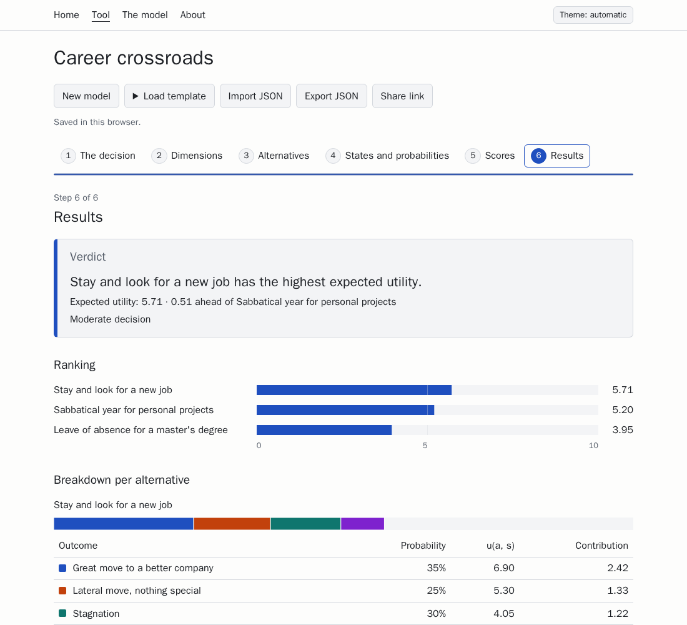

# Argmax

**Decision making under uncertainty, with the math in plain sight.**

$$a^* = \arg\max_{a} \; \mathbb{E}[u(a)]$$

Argmax walks you through a structured decision: list your alternatives, the outcomes each one could lead to and how likely you think they are, the dimensions you care about and how much, and score every outcome. It computes the expected utility of each alternative, its risk profile, the exact tipping points where the ranking would change, and a sensitivity analysis.



- **Private.** Everything runs in your browser. No server, no cookies, no analytics, no requests to third parties.
- **Rigorous.** The full mathematical model is written down in [`docs/MODEL.md`](docs/MODEL.md), and every result is checked against an independent Python implementation.
- **Open.** MIT licensed. Run it yourself with one command.

> The model does not decide for you. It makes your beliefs explicit and checks that they are consistent.

## Try it

**Online:** _the public demo will be on Cloudflare Pages with the first release._

**With Docker**, using the published image (from v1.0.0):

```bash
docker run --rm -p 8080:8080 ghcr.io/jtravesi/argmax:latest
```

or from a clone of this repository:

```bash
docker compose up --build
```

Then open <http://localhost:8080>. The container runs as a non-root user with a read-only filesystem and sends strict security headers. Put a reverse proxy (Caddy, Traefik, nginx…) in front of it for TLS.

## What it does

1. **Describe the decision**: your alternatives and, for each one, the possible outcomes with their probabilities.
2. **Say what matters**: the dimensions you care about, their weights, and a score from 0 to 10 for every outcome.
3. **Read the result**: the expected utility of each alternative, its risk profile (worst and best case, standard deviation, chance of a bad outcome), dominance between alternatives, "what if" sliders, tipping points for every weight and probability, and a tornado diagram.

Models can be exported and imported as JSON, or shared as a link that carries the whole model in its fragment (the part after `#`, which never reaches a server). Four templates help you start.

## Development

Requires Node 24 and Python 3.10+.

```bash
npm ci
npm run dev                 # http://localhost:5173
npm run check               # svelte-check and types
npm run lint                # Prettier and ESLint
npm test                    # unit and property tests (Vitest, fast-check)
npm run test:e2e            # end-to-end tests (Playwright) against the build
python3 -m pytest python/   # the Python oracle
```

`BASE_PATH` sets the path the site is served from (empty by default). To run the end-to-end tests against a running site, such as the Docker image, set `BASE_URL`.

Project documents: [`docs/SPEC.md`](docs/SPEC.md) (what to build), [`docs/MODEL.md`](docs/MODEL.md) (the mathematics, the source of truth), [`docs/ARCHITECTURE.md`](docs/ARCHITECTURE.md) (how it is built) and [`docs/ROADMAP.md`](docs/ROADMAP.md).

### Python reference implementation

[`python/argmax.py`](python/argmax.py) implements the same model with no dependencies. It is also the test oracle for the web app.

```bash
python3 python/argmax.py fixtures/career-decision.json --sensitivity
```

## Contributing

Bug reports and ideas are welcome in the [issues](https://github.com/jtravesi/argmax/issues). For pull requests:

- Read [`docs/MODEL.md`](docs/MODEL.md) before touching the mathematics in `src/lib/core/`. If the code and the document disagree, the document wins; if you think the document is wrong, open an issue.
- Keep the core pure (no Svelte, DOM or storage) and add tests: the oracle in `fixtures/` must keep passing to `1e-9`.
- Put every UI string in `src/lib/i18n/en.ts`.
- Use [Conventional Commits](https://www.conventionalcommits.org/) and run `npm run check && npm run lint && npm test && python3 -m pytest python/` before pushing.

## License

[MIT](LICENSE) © José Carlos Travesí
